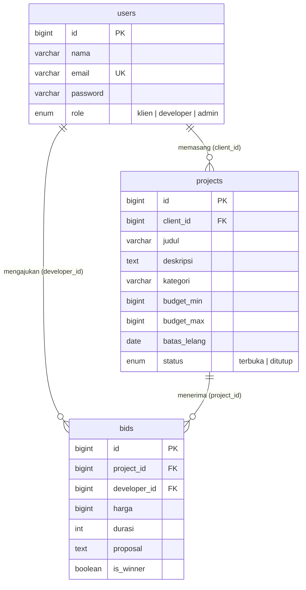

# Garuda-Hub (Laravel 12)

**Garuda-Hub** merupakan platform berbasis web untuk mempertemukan klien dengan developer melalui sistem lelang proyek di bidang teknologi informasi. Klien dapat mempublikasikan pekerjaan yang dibutuhkan, sementara developer bisa mengirimkan penawaran berupa harga, estimasi pengerjaan, dan proposal. Selanjutnya, klien menentukan developer yang paling sesuai untuk mengerjakan proyek tersebut.

Versi ini merupakan pengembangan dari prototype PHP Native menjadi aplikasi menggunakan **Laravel 12**, dengan menerapkan konsep **Model-View-Controller (MVC)** serta pengelolaan database menggunakan **Eloquent ORM**.

Source code prototype PHP Native tetap tersedia pada branch `main`, termasuk file `src/index.php`, `src/database.sql`, dan folder `prototype/`.

> **Catatan:** Aplikasi ini ditujukan untuk kebutuhan pembelajaran dan penggunaan di lingkungan lokal. Seluruh akun dan informasi yang tersedia merupakan data simulasi. Hindari penggunaan informasi pribadi maupun kata sandi yang sebenarnya.

## Instalasi dan Konfigurasi

### Persyaratan Sistem

Sebelum menjalankan aplikasi, pastikan perangkat sudah memiliki beberapa kebutuhan berikut:

- PHP versi 8.2 atau lebih baru.
- Composer.
- MySQL atau MariaDB.
- Laragon sebagai lingkungan pengembangan lokal. Tanpa Laragon, database `garuda_hub_laravel` dapat dibuat lewat phpMyAdmin atau HeidiSQL.

### Langkah Menjalankan Aplikasi

Buka terminal pada direktori proyek, kemudian jalankan perintah berikut secara berurutan:

```bat
composer install
copy .env.example .env
php artisan key:generate
mysql -u root -e "CREATE DATABASE garuda_hub_laravel"
php artisan migrate:fresh --seed
php artisan serve
```

Setelah seluruh proses selesai, akses aplikasi melalui browser dengan alamat:

http://localhost:8000

### Akun untuk Pengujian

Aplikasi menyediakan beberapa akun bawaan berdasarkan hak akses masing-masing pengguna.

| Role | Email | Password |
|---|---|---|
| Admin | admin@example.com | admin123 |
| Klien | budi@example.com | klien123 |
| Developer | dewi@example.com | dev123 |

Untuk memastikan seluruh fungsi aplikasi berjalan sebagaimana mestinya, pengujian dapat dilakukan menggunakan perintah:

```bat
php artisan test
```

## Implementasi Arsitektur MVC

Pengembangan Garuda-Hub menggunakan pola MVC untuk memisahkan pengelolaan data, tampilan antarmuka, dan proses bisnis aplikasi. Pembagian komponen dalam proyek adalah sebagai berikut:

| Komponen | Direktori | Tanggung Jawab |
|---|---|---|
| Model | `app/Models` | Mengelola entitas User, Project, dan Bid beserta relasi antar tabel menggunakan Eloquent. |
| View | `resources/views` | Menyediakan tampilan berbasis Blade, mencakup layout, autentikasi, proyek, penawaran, dashboard, dan halaman admin. |
| Controller | `app/Http/Controllers` | Menangani alur aplikasi melalui AuthController, ProjectController, BidController, DashboardController, dan AdminController. |
| Form Request | `app/Http/Requests` | Melakukan pemeriksaan input melalui RegisterRequest, ProjectRequest, dan BidRequest. |
| Authorization | `app/Policies` dan `app/Http/Middleware/EnsureRole.php` | Mengatur izin pengguna dalam melakukan tindakan tertentu serta membatasi akses berdasarkan role menggunakan middleware `role:`. |
| Routing | `routes/web.php` | Mendefinisikan alamat dan alur permintaan aplikasi berdasarkan kelompok hak akses. |
| Migration | `database/migrations` | Mendefinisikan struktur tabel dan perubahan skema database. |
| Seeder | `database/seeders/DatabaseSeeder.php` | Mengisi database dengan data dummy. Akun pengguna diambil dari `src/database.sql` pada branch `main`, sedangkan data proyek dan penawaran dibuat baru. |

## Perancangan Database

Garuda-Hub menggunakan tiga tabel utama yang saling terhubung, yaitu `users`, `projects`, dan `bids`.

Hubungan antarentitas database dapat digambarkan melalui ERD berikut:



### Penyempurnaan Struktur Database

Dibandingkan dengan rancangan database pada prototype sebelumnya (`prototype/mocks/database.sql` di branch `main`), versi Laravel ini menerapkan sejumlah peningkatan untuk menjaga konsistensi dan validitas data.

1. **Pembatasan data email:** Kolom `users.email` menggunakan UNIQUE constraint agar setiap akun memiliki alamat email yang berbeda.
2. **Penggunaan ENUM:** Kolom `role` pada tabel users dan `status` pada tabel projects menggunakan ENUM sehingga nilai yang dimasukkan hanya dapat berasal dari pilihan yang telah ditentukan.
3. **Relasi Foreign Key:** Hubungan antara tabel dibuat menggunakan foreign key, yaitu:
   - `projects.client_id` mengacu pada `users.id`.
   - `bids.project_id` mengacu pada `projects.id`.
   - `bids.developer_id` mengacu pada `users.id`.

   Seluruh relasi tersebut menggunakan aturan `ON DELETE CASCADE` sehingga data yang berkaitan ikut terhapus ketika data induknya dihapus.
4. **Pencegahan penawaran ganda:** Kombinasi `project_id` dan `developer_id` diberikan UNIQUE constraint. Dengan demikian, seorang developer tidak dapat mengirimkan lebih dari satu penawaran untuk proyek yang sama.
5. **Validasi nilai:** CHECK constraint diterapkan untuk memastikan `budget_max` tidak lebih kecil dari `budget_min`, serta nilai `harga` dan `durasi` harus lebih besar dari nol. Fitur ini memerlukan MySQL 8.0.16+ atau MariaDB yang mendukung CHECK constraint.
6. **Optimasi pencarian:** Index ditambahkan pada beberapa kolom penting, seperti `status`, `kategori`, `role`, serta kolom-kolom foreign key untuk membantu meningkatkan efisiensi query.

## Implementasi CRUD Menggunakan Eloquent ORM

Operasi Create, Read, Update, dan Delete pada aplikasi dilakukan melalui Eloquent ORM. Setiap model memiliki relasi yang digunakan untuk mempermudah pengelolaan data tanpa harus menuliskan query SQL secara manual untuk setiap operasi.

| Entitas | Create | Read | Update | Delete |
|---|---|---|---|---|
| Project (Klien) | `$user->projects()->create()` | `Project::with('client')->withCount('bids')->search()` | `$project->update()` | `$project->delete()` |
| Bid (Developer) | `$bid->project()->associate()->save()` | `$project->bids`, `$user->bids()` | `$bid->update()` | `$bid->delete()` |
| User (Admin) | `$user->save()` saat registrasi | `User::withCount()` | `forceFill(['role'])` | `$user->delete()` |

### Mekanisme Pemilihan Pemenang

Proses penentuan developer terpilih menggunakan fitur transaksi database melalui `DB::transaction()` yang dikombinasikan dengan `lockForUpdate()`.

Baris proyek dikunci selama transaksi, sehingga satu proyek tidak bisa memiliki dua pemenang meskipun tombol pilih pemenang diklik bersamaan.

## Lisensi

Proyek Garuda-Hub menggunakan lisensi **MIT License**. Informasi lengkap mengenai ketentuan penggunaan dan distribusi dapat ditemukan pada file `LICENSE` di direktori utama proyek.
